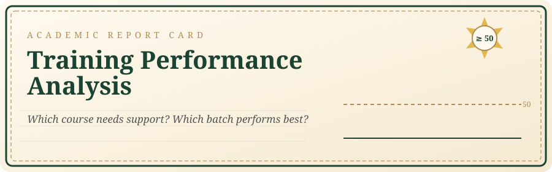
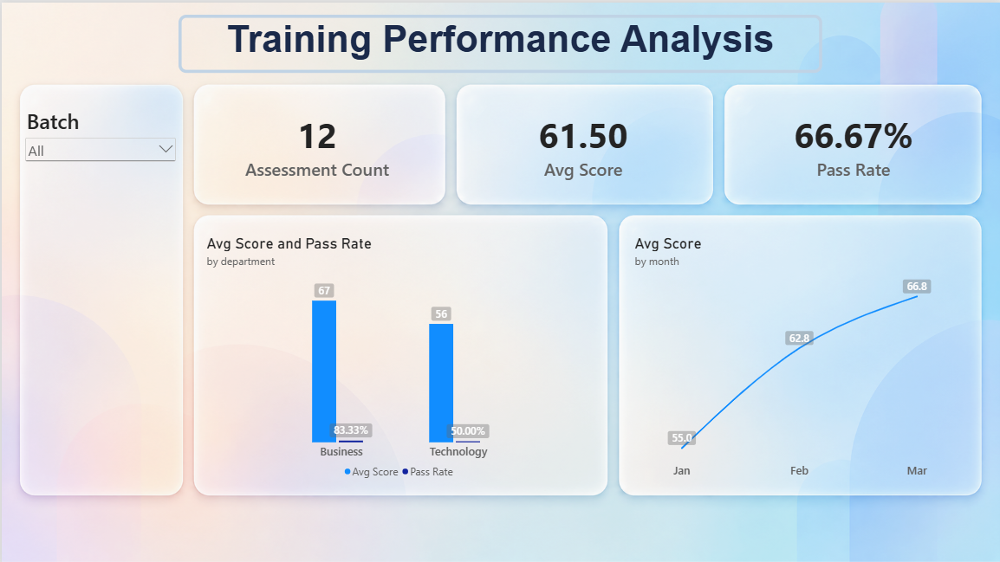

<p align="center">
  
</p>

<p align="center">
  <a href="YOUR_VIDEO_LINK_HERE"><b>🎬 WATCH THE VIDEO WALKTHROUGH</b></a><br>
  <sub>⏱ Duration: ___ minutes</sub>
</p>

<p align="center">
  
  
  
  
  
</p>

---

## 🖼️ POWER BI DASHBOARD

<p align="center">
  
</p>

---

## 🎓 STUDENT REPORT CARD

```text
╔═══════════════════════════════════════════════════════╗
║          TRAINING PERFORMANCE ANALYSIS                ║
║          Data Analysis Practical · Set A              ║
╠═══════════════════════════════════════════════════════╣
║   Student Name   :  Mayur Makwana                     ║
║   Student ID     :  11391                             ║
║   Set            :  C                                 ║
║   Records        :  12 clean records                  ║
║   Pass Mark      :  score ≥ 50                        ║
║   Result         :  ✅ ANALYSIS COMPLETE              ║
╚═══════════════════════════════════════════════════════╝
```

---

## 📘 OBJECTIVE

Analyze the given data, clean duplicate records, calculate the required metrics, and answer the business questions using **Excel, SQL, Python and Power BI**.

---

## ✏️ EXAM QUESTIONS

> **Q1.** Which course needs the most academic support?
>
> **Q2.** How does performance differ across batches?

---

## 📚 SYLLABUS (Dataset)

| Subject | File | Type |
|---|---|---|
| 📝 Assessments | `data/raw/assessments.csv` | Fact data |
| 📖 Courses | `data/raw/courses.csv` | Lookup data |

Duplicate records were removed, leaving **12 clean records**.

---

## 🧮 GRADING SCHEME (Cleaning & Metrics)

**Cleaning**

1. Removed the exact duplicate row
2. Joined data using `course_id`

**Formulas**

```text
pass_flag = (score >= 50)
pass_rate = pass_flag_count / all_records × 100
```

---

## 🖊️ TEACHER'S REMARKS (Findings)

| | Remark |
|:-:|---|
| **1** | **Python needs the most academic support.** Its passing rate is **33.33%**, the lowest compared to every other course. |
| **2** | **The Weekend batch performs weakest.** It has only **2 passes**, the lowest compared to the Morning and Evening batches. |

> 📌 **Recommendation:**
> 1. Increase the number of Python classes and focus on improving its passing rate.
> 2. Conduct more classes in the Morning and Evening batches.

---

## 🔍 MODERATION (Cross-tool Reconciliation)

**Aggregate checked:** average score (Jan)

```text
 Excel      ██████████████████████████  55
 SQL        ██████████████████████████  55
 Python     ██████████████████████████  55
 Power BI   ██████████████████████████  55
```

✅ All four tools agree. Any difference is only due to rounding.

---

## 📖 REVISION GUIDE (Setup & Run)

<details>
<summary><b>🐬 SQL</b></summary>

Run `sql/setup.sql` first, then `sql/queries.sql`.
</details>

<details>
<summary><b>🐍 Python</b></summary>

Install packages:

```bash
pip install -r requirements.txt
```

Run from the repository root:

```bash
python python/analysis.py
```
</details>

<details>
<summary><b>📗 Excel</b></summary>

Open `excel/analysis.xlsx`.
</details>

<details>
<summary><b>📊 Power BI</b></summary>

Open `powerbi/dashboard.pbix` and update the CSV path if required.
</details>

---

## 🎒 SCHOOL BAG (Project Structure)

```text
📁 training-performance-analysis
 ├─ 📁 data/raw     assessments.csv, courses.csv
 ├─ 📁 excel        analysis.xlsx
 ├─ 📁 sql          setup.sql, queries.sql
 ├─ 📁 python       analysis.py
 ├─ 📁 powerbi      dashboard.pbix
 ├─ 📁 outputs      analysis results and charts
 ├─ 📁 assets       report_header.svg
 └─ 📄 requirements.txt
```

---

<p align="center">
  <b>✍️ Student's Signature:</b> Mayur Makwana · ID 11391<br>
  <sub>All work in this repository is my own except where cited.</sub>
</p>
